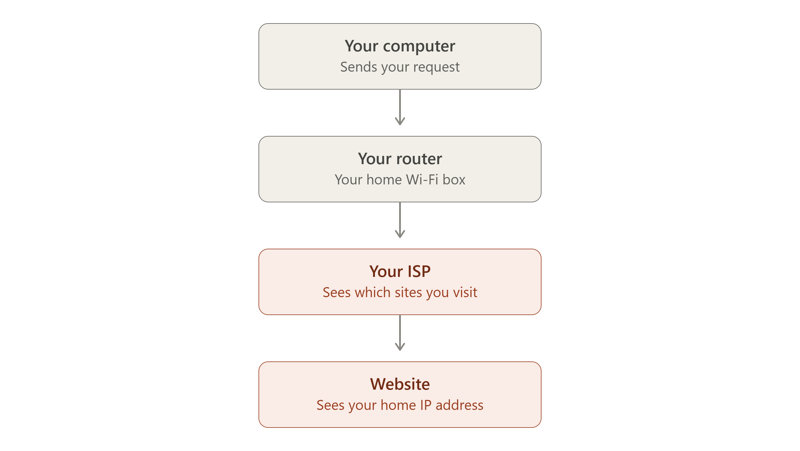
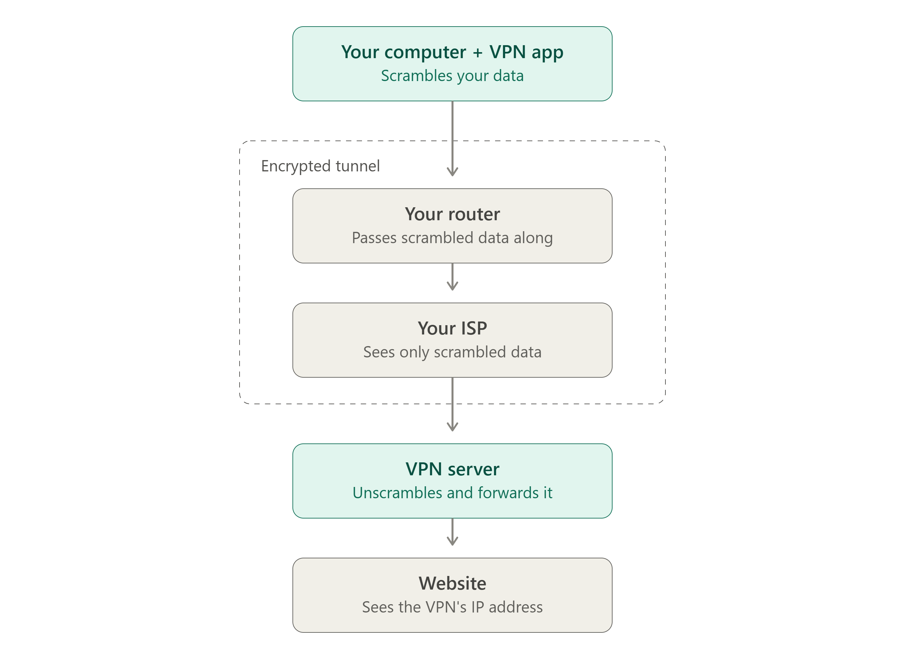

# How does a VPN work?

## Without a VPN

The first chart shows the path without a VPN. Everything travels in one straight line, and each stop can see where your traffic is headed.

## With a VPN

The second chart shows the same trip with a VPN. Your data still passes through your router and ISP, but it's scrambled before it leaves your computer, so they can't read it or see which site you're visiting. The VPN server unscrambles it and passes it on, so the website sees the VPN's address instead of yours.

## Two things worth knowing

- **The VPN takes over the ISP's view.** Your ISP can no longer see where you're going, but the VPN provider can, so you're shifting trust rather than removing it.
- **Your ISP still knows you're using a VPN.** It can see that you're connected to a VPN server and how much data you're sending, just not what's inside.

> **Note:** Replies travel back along the same path in reverse.
